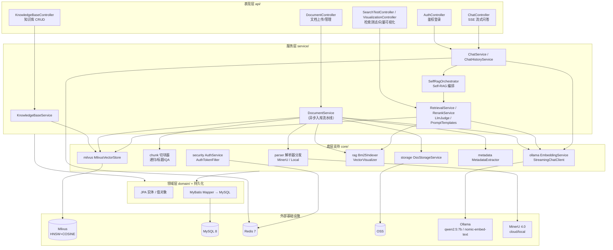
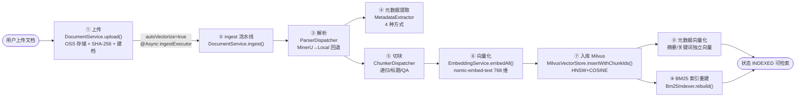
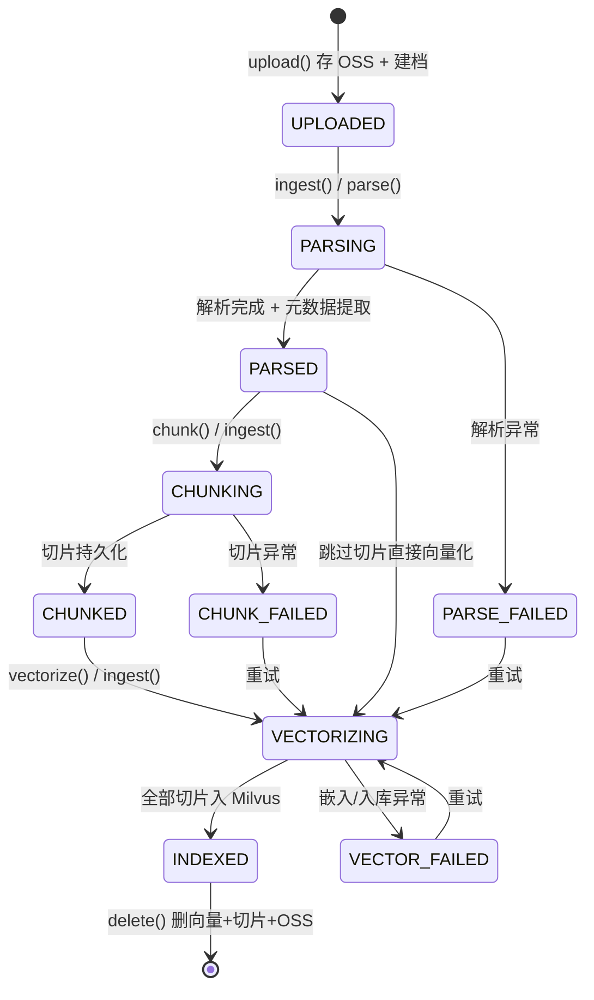
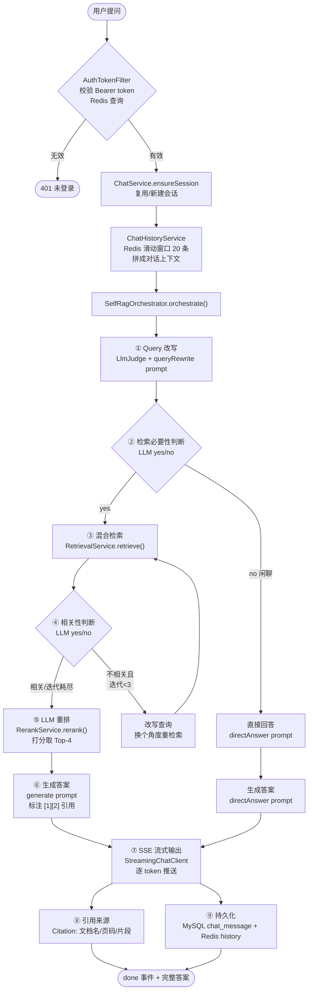
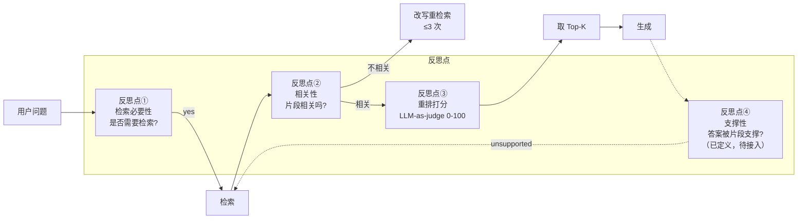

# pomelo-ai 核心流程与技术实现

> 本文档面向论文撰写，从源码层面梳理 pomelo-ai（基于 Java 的 RAG 脚手架）的两条核心链路：**知识库构建流水线**与 **Self-RAG 智能问答**，逐步说明每一步"用了什么技术、做了什么"，并附 Mermaid 流程图。

---

## 一、项目定位与技术栈

pomelo-ai 是一个从 0 到能问答的 **Java RAG 脚手架**，完整覆盖「文档解析 → 切块 → 向量化 → 入向量库 → 混合检索 → LLM 重排 → Self-RAG 编排 → 流式问答 + 引用来源」全链路。

| 层次 | 组件 | 版本 | 作用 |
|---|---|---|---|
| 语言/框架 | JDK / Spring Boot | 21 / 4.1.2 | Web + MyBatis + Redis |
| LLM 框架 | langchain4j | 1.23.0 | ChatModel + EmbeddingModel（Ollama 原生 / OpenAI 兼容）|
| 向量库 | Milvus Java SDK | 3.0.12 | MilvusClientV2（服务端 v3.0.0）|
| 关系库 | MySQL | 8.0 | 知识库 / 文档 / 切片 / 会话元数据 |
| 缓存 | Redis | 7 | 会话历史 + 鉴权 token |
| 对象存储 | 阿里云 OSS | 3.18.5 | 源文件存储（替代本地磁盘）|
| 文档解析 | MinerU 4.0 / PDFBox 3.0.8 / POI 6.0.0 | — | 远程富解析 / 本地兜底 |
| 嵌入模型 | `bge-m3`（dev 本地 Ollama）/ `BAAI/bge-m3`（release 硅基流动）| **1024 维** | 向量化 + 查询向量化 |
| 对话模型 | dev `qwen2.5:7b`（Ollama）/ release `deepseek-chat`（DeepSeek API）| — | 生成 + 重排 + Self-RAG 判断 + Query 改写 + 元数据提取 |

> **注**：README/启动指南中标注的 `nomic-embed-text`(768 维) 为早期版本，**实际代码配置（application-dev.yml / application-release.yml）已统一切换为 `bge-m3`（1024 维）**。`LlmConfig` 与 `MilvusVectorStore` 均通过 `${pomelo.llm.embed-dimension}` 动态读取维度，Milvus Collection 在维度不匹配时自动删除重建。本文档参数以实际代码配置为准。

---

## 二、系统总体架构

依赖方向单一向下：`api → service → core → domain`，`common` 横切复用。



**端口一览**：应用 8080 / MySQL 3306 / Redis 6379 / Milvus 19530·9091 / Attu 3000 / MinIO 9000·9001 / etcd 2379 / Ollama 11434 / MinerU 8000。

---

## 三、核心流程一：知识库构建（文档入库流水线）

### 3.1 总体流程图



### 3.2 文档状态机

文档入库全程由状态机驱动，每个阶段独立、可重试、可断点续跑：



> 切片自身也有子状态：`PENDING → VECTORIZED`，编辑后变 `EDITED`（需重新向量化），失败变 `FAILED`。

### 3.3 逐步详解

#### ① 知识库创建 — `KnowledgeBaseService.create()`
- **技术**：MySQL（`knowledge_base` 表）+ Milvus Collection。
- **做了什么**：
  1. 落库知识库配置（切块大小默认 500、重叠 50、Top-K 8、重排数 4、相似度阈值 0.3、切块策略 `general`、自动向量化默认关）。
  2. 调 `MilvusVectorStore.ensureCollection()` **预建向量集合**：每个知识库对应一个独立 Collection（命名 `pomelo_{kbId}`，UUID 中的 `-` 替换为 `_`）。
  3. 若已存在 Collection 但向量维度与当前配置不符，**自动删除重建**。
  4. `initDefaultFieldConfigs()` 初始化 **13 个默认元数据字段**（文件名/标题/作者/机构/发布日期/关键词/摘要/主题/术语/指标/向量化状态等）。

#### ② 文档上传 — `DocumentService.upload()`
- **技术**：阿里云 OSS（`OssStorageService`）+ SHA-256（`MessageDigest`）+ MySQL（`doc` 表）。
- **做了什么**：
  1. 文件上传到 OSS，存储对象路径而非本地磁盘。
  2. 计算 SHA-256 文件指纹（用于重复检测 / 增量判断）。
  3. 创建 `Document` 实体，状态置 `UPLOADED`。
  4. 若知识库开启 `autoVectorize`，通过**自注入代理对象** `self.ingest()` 异步触发完整流水线（保证 `@Async` 生效，且 insert 已提交使异步任务可查到文档）。

#### ③ 文档解析 — `ParserDispatcher.parse()`
- **技术**：MinerU 4.0（云端 `mineru.net` VLM 模式 / 本地 HTTP）/ PDFBox 3.0.8 / POI 6.0.0。
- **分发策略**：MinerU `enabled` 且支持该格式时**优先用 MinerU**；MinerU 失败或不可用时**自动回退** `LocalParser`。
- **LocalParser 实现**：
  - PDF：`PDFBox.Loader` + `PDFTextStripper`，**按页**提取文本，按空行切段，保留页码（用于引用定位）。
  - Word(.docx)：`POI XWPFDocument`，按段落提取。
  - TXT/MD：直接读取，按空行切段。
- **输出**：`ParsedDocument`（含 `List<ParsedBlock>`，每个 block 带 text + page）。解析纯文本同时写入 `doc.parsed_content`。
- **状态**：`PARSING → PARSED`（失败 `PARSE_FAILED`）。从 OSS 下载到临时文件解析，完成后删除临时文件。

#### ④ 元数据提取 — `MetadataExtractor.extract()`
- **技术**：PDFBox/POI 文档属性 + 正则 + langchain4j `ChatModel`（qwen2.5:7b）。
- **按字段配置的 `extractType` 四种方式分发**：
  | 方式 | 实现 | 示例字段 |
  |---|---|---|
  | `SYSTEM` | 直接取系统值 | file_name / create_time / vector_status |
  | `DOC_PROPERTY` | PDFBox `PDDocumentInformation` / POI `CoreProperties` | title / author / publish_date |
  | `REGEX` | `Pattern.compile` 从正文匹配 | 自定义规则 |
  | `LLM` | 多字段**合并为一次调用**，截取正文前 3000 字，要求返回 JSON | keywords / summary / topic / terms / metrics |
- **成本优化**：LLM 字段批量合并（1 次调用提取 5+ 字段），从响应中容错提取 JSON。
- **输出**：写入 `doc_metadata` 表（doc_id, field_key, field_value）。

#### ⑤ 文档切块 — `ChunkerDispatcher.chunk()`
- **技术**：策略模式，按知识库 `chunkStrategy` 选择切分器。
- **三种策略**：

  **(a) 通用切片 `RecursiveCharChunker`（默认）**
  - 递归字符分割：分隔符层次 `["\n\n", "\n", "。", "！", "？", ". ", "! ", "? ", " ", ""]`。
  - 超出 `chunkSize`（默认 500）时先按粗分隔符切，仍超长则用更细分隔符递归；最终按字符硬切。
  - 保留 `overlap`（默认 50）：上一块尾部带入下一块开头，避免语义断裂。
  - 保留页码元数据（继承自解析 block）。

  **(b) 按标题层级 `HeadingChunker`**
  - 正则识别 Markdown 标题（`#`~`######`）或中文编号（`第X章`/`一、`/`（一）`/`1.`）。
  - 按标题分段，保留层级标题作为上下文前缀；超长段落用通用切分兜底。

  **(c) QA 问答对 `QaChunker`**
  - 用 LLM 从正文批量生成「问题-答案」对（每批 4000 字，最多 8 对/批），切片内容 = `"Q: 问题\nA: 答案"`。
  - 答案向量化，检索时问题措辞差异大也能语义匹配。成本较高，适合 FAQ。
- **输出**：`List<TextChunk>`（text + page + index），持久化为 `doc_chunk` 表（含 content_hash 用于增量检测），切片状态 `PENDING`。
- **状态**：`CHUNKING → CHUNKED`。

#### ⑥ 向量化 — `EmbeddingService.embedBatch()`
- **技术**：langchain4j `EmbeddingModel.embedAll()`，底层为 `OllamaNativeEmbeddingModel`（dev）或 `OpenAiEmbeddingModel`（release）。
- **模型**：`bge-m3`（dev 本地 Ollama）/ `BAAI/bge-m3`（release 硅基流动），**1024 维**。
- **OllamaNativeEmbeddingModel 关键实现**：继承 `DimensionAwareEmbeddingModel`；因 Ollama 0.40.x 的 `/api/embed` 在**数组（批量）模式**下会触发 runner 不支持的 `/tokenize` 端点，故采用**逐条发送（input 为字符串非数组）+ 8 并发线程池**（`Executors.newFixedThreadPool(8)` + `invokeAll`）兼顾可靠性与速度（约 70 条切片 9 秒）。
- **做了什么**：将每个 `TextChunk` 转 `TextSegment`，批量嵌入，返回与输入同序的 `List<float[]>`。
- **状态**：`VECTORIZING`。

#### ⑦ 入库 Milvus — `MilvusVectorStore.insertWithChunkIds()`
- **技术**：Milvus Java SDK V2（`MilvusClientV2.insert`）。
- **Collection Schema（10 字段）**：

  | 字段 | 类型 | 说明 |
  |---|---|---|
  | id | Int64 | 主键，自增 |
  | vector | FloatVector(1024) | 嵌入向量（维度由 `${pomelo.llm.embed-dimension}` 决定）|
  | kb_id | VarChar(64) | 知识库 ID |
  | doc_id | VarChar(64) | 文档 ID |
  | doc_name | VarChar(255) | 文档名 |
  | page | Int32 | 页码 |
  | chunk_index | Int32 | 切片序号 |
  | text | VarChar(8192) | 切片原文（输出字段） |
  | vec_type | VarChar(32) | 向量类型：content/summary/keywords |
  | chunk_id | VarChar(64) | 切片 ID（对应 doc_chunk 表，用于增量删除）|

- **索引**：**HNSW + COSINE**（余弦距离），参数 `M=16, efConstruction=200`，一致性 `STRONG`。
- **做了什么**：批量插入向量行（text 超 8000 字截断），同时写入 `chunk_id` 以支持按切片增量删除。
- **状态**：切片 `VECTORIZED`，文档 `INDEXED`。

#### ⑧ 元数据向量化 — `DocumentService.vectorizeMetadata()`
- **技术**：复用 `EmbeddingService.embedQuery()` + `MilvusVectorStore.insertMetadataVector()`。
- **做了什么**：对字段配置中 `vectorized=true` 的元数据（如**摘要 summary、关键词 keywords**）生成独立向量，`vec_type` 标记为 `summary`/`keywords` 入同一 Collection。
- **意义**：检索时正文 + 摘要 + 关键词**多路召回**，提升召回率。

#### ⑨ BM25 索引重建 — `Bm25Indexer.rebuild()`
- **技术**：内存倒排索引（`ConcurrentHashMap`，按 kbId 隔离）。
- **做了什么**：从 MySQL 加载该知识库所有 `VECTORIZED` 切片，构建 BM25 索引（参数 `K1=1.5, B=0.75`；中文 bigram + 英文空格分词）。
- **意义**：为混合检索提供关键词召回通道；支持增量更新（切片编辑时 `updateChunk`）。

### 3.4 异步与并发控制

- **线程池**：`AsyncConfig.ingestExecutor`，`@EnableAsync`，核心 2 / 最大 4 / 队列 50，拒绝策略 `CallerRunsPolicy`（队列满时调用线程执行，天然限流防 Ollama 过载）。
- **解耦设计**：上传、解析、切片、向量化四阶段均可独立触发（`parse()`/`chunk()`/`vectorize()`/`ingest()`），支持批量（`batchVectorize`）、全库（`vectorizeAll`）、增量（`incrementalVectorize` 只重嵌 `EDITED/FAILED/PENDING` 切片）。
- **自调用代理**：`@Lazy` 自注入 `self` 解决 `@Async`/`@Transactional` 自调用失效问题。

---

## 四、核心流程二：Self-RAG 智能问答

### 4.1 总体流程图



### 4.2 逐步详解

#### ① 鉴权 — `AuthTokenFilter` + `AuthService`
- **技术**：Spring `OncePerRequestFilter`（`@Order(1)`）+ Redis + BCrypt（`spring-security-crypto`，未引入完整 Spring Security 过滤链）。
- **做了什么**：
  - 拦截 `/api/**`（白名单：`/api/auth/login`、`/api/doc/image/`、`/actuator`、`/error`）。
  - 从 `Authorization: Bearer xxx` 或 `?token=` 提取 token，查 Redis（`pomelo:auth:token:{token}` → `userId:username:role`）。
  - 登录时：BCrypt 校验密码 → 生成 UUID token → 存 Redis，TTL 默认 **720 分钟**。启动时自动初始化默认管理员。
- **RBAC 三角色**：admin（全权限）/ operator（可管理文档）/ user（只读 + 对话）。

#### ② 会话与历史 — `ChatService.ensureSession()` + `ChatHistoryService`
- **技术**：MySQL（`chat_session`/`chat_message`）+ Redis（`StringRedisTemplate`）。
- **做了什么**：
  - 复用或新建会话（标题取消息前 30 字）。
  - 持久化用户消息到 MySQL；同时 `append()` 写入 Redis 历史。
  - **Redis 滑动窗口**：保留最近 **20 条**消息，TTL **7 天**；`asContext()` 拼成「用户：…/助手：…」纯文本上下文供 prompt 使用。

#### ③ Query 改写 — `SelfRagOrchestrator` + `LlmJudge` + `PromptTemplates.queryRewrite`
- **技术**：langchain4j `ChatModel.chat()`（qwen2.5:7b）。
- **做了什么**：结合多轮对话历史，将用户最新问题改写为**独立、完整、利于向量检索**的查询（解决多轮对话中指代消解问题）。失败则用原查询。
- **Prompt 要点**：「只输出改写后的查询，不要解释，不要加引号」。

#### ④ 检索必要性判断 — `PromptTemplates.retrievalNecessity`
- **技术**：LLM 二分类（yes/no）。
- **做了什么**：判断问题是否需要检索知识库。
  - 需要事实/数据/特定文档内容 → `yes`
  - 闲聊、打招呼、通用常识 → `no`，**直接跳过检索**走 `directAnswer`。
- **降级**：判断失败时默认检索（宁可检索不漏）。

#### ⑤ 混合检索 — `RetrievalService.retrieve()`
- **技术**：Milvus 向量检索 + 内存 BM25 + **RRF（Reciprocal Rank Fusion）融合**。
- **召回通道（四路）**：

  | 通道 | 召回数 | RRF 权重 | 说明 |
  |---|---|---|---|
  | 向量·正文 content | Top-K（默认 8） | 1.0 | 主语义召回 |
  | 向量·摘要 summary | Top-K/2+1 | 0.5 | 元数据摘要向量 |
  | 向量·关键词 keywords | Top-K/2+1 | 0.5 | 元数据关键词向量 |
  | BM25 关键词 | Top-K×2 | 0.8 | 精确关键词匹配 |

- **RRF 融合公式**：`score(d) = Σ w_channel / (K + rank_channel(d))`，其中 `K=60`。
- **过滤**：按知识库 `similarity_threshold`（默认 0.3）过滤 + 排除**停用文档**（Milvus filter `doc_id not in [...]`）+ 按 `kb_id` 过滤 + 截断 Top-K。
- **检索测试**：`retrieveForTest()` 提供纯向量召回（可自定义 Top-K/阈值，不含 BM25），用于调参对比。

#### ⑥ 相关性判断 + 迭代重检索 — `PromptTemplates.relevance`
- **技术**：LLM 二分类（yes/no）。
- **做了什么**：判断检索片段是否与问题相关、可用于回答。
  - **不相关且迭代次数 < `max-iterations`（默认 3）** → 换个角度改写查询（`"检索结果不理想，请换个角度改写"`）→ **重新检索**。
  - 相关或迭代耗尽 → 进入重排。
- **降级**：判断失败默认相关。

#### ⑦ LLM 重排 — `RerankService.rerank()`
- **技术**：LLM-as-judge 打分（以对话模型 qwen2.5:7b / deepseek-chat 作为判官）。
- **做了什么**：
  - Prompt 要求对每个片段按与查询相关性打分（0-100），格式 `序号|分数`。
  - 正则 `(\\d+)\\s*\\|\\s*(\\d+(?:\\.\\d+)?)` 解析每行分数。
  - 按分数降序，取 **`rerank-top-k`（默认 4）** 进入最终上下文。
- **降级**：LLM 调用失败或未按格式输出 → 按原顺序截断（保证可用性）。

#### ⑧ 答案生成 — `PromptTemplates.generate()`
- **技术**：StreamingChatClient 流式生成。
- **做了什么**：基于重排后的检索片段 + 对话历史生成答案，关键规则：
  1. 若片段不足以回答 → 明确说明「根据现有知识库内容无法回答」，**不编造**（防幻觉）。
  2. 引用到的内容在句末用 **`[1][2]` 标注来源序号**。
  3. 片段以编号 +（文档名, 页码）格式注入 prompt。
- **直接回答路径**（无需检索时）：用 `directAnswer` prompt，仅基于对话历史回答。

#### ⑨ SSE 流式输出 — `StreamingChatClient.streamChat()`
- **技术**：JDK `HttpClient`（`BodyHandlers.ofLines()` 逐行流），**双后端**：
  - **Ollama**：POST `/api/chat`，解析 **NDJSON** 流，每行取 `message.content`。
  - **OpenAI 兼容**（DeepSeek 等）：POST `/chat/completions`，解析 **SSE** `data:` 流，每块取 `choices[0].delta.content`，遇 `[DONE]` 结束。
- **做了什么**：逐 token 回调 `Consumer<String> onToken`，通过 `ChatController` 以 SSE `event:token` 推送前端；生成完成后发 `event:done` 携带完整答案 + 引用。
- **设计取舍**：不依赖 langchain4j 流式 API，自行实现以保证双后端兼容与真实流式。

#### ⑩ 引用来源 — `Citation`
- **字段**：文档名（docName）、页码（page）、片段（snippet，截取前 120 字）、切片序号。
- **做了什么**：重排后的 `RetrievedChunk` 转 `Citation`，随 done 事件返回，前端展示引用来源卡片。

#### ⑪ 持久化 — MySQL + Redis
- **做了什么**：助手答案 + 引用 JSON 持久化到 MySQL `chat_message`（role=assistant）；同步 append 到 Redis 历史；更新会话时间。

---

## 五、Self-RAG 自我反思机制分析

Self-RAG 的核心在于用 LLM 在检索-生成链路中引入**多个自我反思判断点**，相比朴素 RAG（检索→生成一步到位）显著提升准确性与抗幻觉能力。



| 反思点 | 实现类/方法 | LLM 输出 | 实际接入状态 |
|---|---|---|---|
| ① 检索必要性 | `LlmJudge.parseYesNo` + `retrievalNecessity` | yes/no | ✅ 已接入，闲聊直接答 |
| ② 相关性 | `LlmJudge.parseYesNo` + `relevance` | yes/no | ✅ 已接入，驱动迭代重检索 |
| ③ 重排打分 | `RerankService` + `rerank` | 序号\|分数 0-100 | ✅ 已接入，取 Top-K |
| ④ 答案支撑性 | `LlmJudge.parseSupported` + `supportCheck` | supported/unsupported | ⚠️ **Prompt 与解析方法已定义，尚未接入主循环**（当前以相关性判断驱动迭代） |

> **论文注意**：当前实现的迭代终止依据是**检索片段相关性**（反思点②），而非生成答案的支撑性（反思点④）。`supportCheck` 模板与 `parseSupported` 解析器已就绪，属于预留扩展点。这是与原始 Self-RAG 论文（答案粒度反思）的一个实现差异，可在论文中作为「设计演进方向」讨论。

**与朴素 RAG 的关键差异**：
1. **检索前**判断必要性，闲聊不浪费检索资源；
2. **检索后**判断相关性，不相关则改写重检索（迭代自适应）；
3. **重排**用 LLM 语义打分替代纯向量相似度，更贴合查询意图；
4. **生成**强制标注引用 + 不足时拒答，提供可溯源性与抗幻觉。

---

## 六、关键技术细节

### 6.1 Milvus 向量库设计
- 每个知识库一个独立 Collection（隔离 + 维度独立）。
- HNSW 图索引 + 余弦距离，兼顾召回率与速度（`M=16, efConstruction=200`）。
- `vec_type` 字段实现**单 Collection 多路向量**（正文/摘要/关键词共存）。
- `chunk_id` 字段支持**按切片精确增量删除**（编辑切片时删旧向量重嵌）。
- 维度不匹配自动重建 Collection（嵌入模型切换场景）。

### 6.2 混合检索 RRF 融合
```
score(d) = Σ_channel  w_channel / (60 + rank_channel(d))
```
- 正文向量权重 1.0、BM25 权重 0.8、摘要/关键词向量权重 0.5。
- 不同通道结果按 chunkId/docId 聚合，累加 RRF 分数后统一排序截断。
- 兼顾**语义召回**（向量）与**精确匹配**（BM25），缓解纯向量对专有名词/编号的弱召回。

### 6.3 双 LLM 后端
- `LlmConfig` 按 `pomelo.llm.provider` 切换：
  - `ollama`：`OllamaNativeChatModel` / `OllamaNativeEmbeddingModel`，直接调原生 `/api/chat`、`/api/embed`，**绕过 langchain4j-ollama 的 `/tokenize` 调用**（兼容 Ollama 0.40.x）。
  - OpenAI 兼容：`OpenAiChatModel` / `OpenAiEmbeddingModel`（支持 DeepSeek / 硅基流动等在线服务）。
- `OllamaNativeEmbeddingModel` 因 Ollama 0.40.x 数组模式触发 `/tokenize`，改用**逐条字符串模式 + 8 并发线程池**。
- 流式生成同样双后端（`StreamingChatClient`）。

**两环境配置对比**（来自 application-dev.yml / application-release.yml）：

| 配置项 | dev（本地） | release（生产） |
|---|---|---|
| provider | `ollama` | `openai-compatible` |
| Chat 模型 | `qwen2.5:7b` @ localhost:11434 | `deepseek-chat` @ api.deepseek.com |
| Embed 模型 | `bge-m3` @ Ollama | `BAAI/bge-m3` @ 硅基流动 |
| 向量维度 | 1024 | 1024 |
| 温度 / max-tokens | 0.7 / 2048 | 0.7 / 2048 |

### 6.4 PCA 向量可视化
- `VectorVisualizer`：对知识库向量做 **PCA 2D 降维**（power iteration 求前两主成分），最多采样 500 条，输出散点图用于直观观察向量分布聚类。
- 无需第三方 t-SNE 库，纯 Java 实现。

### 6.5 切片增量向量化
- 切片编辑后状态置 `EDITED`，旧向量按 `chunk_id` 从 Milvus 删除，BM25 索引增量更新。
- `incrementalVectorize()` 只重嵌 `EDITED/FAILED/PENDING` 切片，不重跑全量。
- 内容哈希（SHA-256）支持增量检测。

---

## 七、数据流总结表

| 阶段 | 主责类 | 技术组件 | 输入 | 输出 | 存储 |
|---|---|---|---|---|---|
| 知识库创建 | KnowledgeBaseService | MySQL + Milvus | 配置 | KB + Collection + 13 字段 | MySQL / Milvus |
| 文档上传 | DocumentService.upload | OSS + SHA-256 | MultipartFile | Document(UPLOADED) | OSS / MySQL |
| 解析 | ParserDispatcher | MinerU / PDFBox / POI | 文件 | ParsedDocument | MySQL(parsed_content) |
| 元数据提取 | MetadataExtractor | 文档属性 / 正则 / LLM | ParsedContent | DocMetadata | MySQL(doc_metadata) |
| 切块 | ChunkerDispatcher | 递归/标题/QA | ParsedDocument | List<TextChunk> | MySQL(doc_chunk) |
| 向量化 | EmbeddingService | bge-m3 1024d | TextChunks | float[] 向量 | — |
| 入库 | MilvusVectorStore | Milvus HNSW+COSINE | 向量+元数据 | 向量行 | Milvus |
| BM25 索引 | Bm25Indexer | 内存倒排 | 切片 | BM25 索引 | 内存 |
| 鉴权 | AuthTokenFilter/AuthService | Redis + BCrypt | token | 角色信息 | Redis |
| Query 改写 | SelfRagOrchestrator/LlmJudge | LLM（qwen2.5:7b / deepseek-chat） | 查询+历史 | 改写查询 | — |
| 检索必要性 | LlmJudge | LLM yes/no | 查询 | 是否检索 | — |
| 混合检索 | RetrievalService | Milvus+BM25+RRF | 查询向量 | Top-K 候选 | — |
| 相关性判断 | LlmJudge | LLM yes/no | 候选片段 | 是否相关 | — |
| 重排 | RerankService | LLM-as-judge | 候选+查询 | Top-4 片段 | — |
| 生成 | StreamingChatClient | LLM 流式（NDJSON/SSE） | 片段+历史 | 答案(带引用) | — |
| 输出 | ChatController | SSE | token 流 | event:token/done | — |
| 引用 | Citation | — | RetrievedChunk | 文档名/页码/片段 | — |
| 持久化 | ChatService | MySQL + Redis | 答案+引用 | 消息记录 | MySQL / Redis |

---

## 七·补充、关键参数速查表（论文可直接引用）

| 参数 | 配置键 / 来源 | 值 |
|---|---|---|
| 检索 Top-K | `pomelo.rag.top-k` / `KnowledgeBase.topK` | 8 |
| 重排 Top-K | `pomelo.rag.rerank-top-k` | 4 |
| 最大迭代次数 | `pomelo.rag.max-iterations` | 3 |
| 相似度阈值 | `KnowledgeBase.similarityThreshold` | 0.3 |
| RRF 参数 K | `RetrievalService.RRF_K` | 60.0 |
| 向量正文 / BM25 / 摘要·关键词 RRF 权重 | `RetrievalService` | 1.0 / 0.8 / 0.5 |
| BM25 K1 / B | `Bm25Indexer` | 1.5 / 0.75 |
| 向量维度 | `pomelo.llm.embed-dimension` | 1024（bge-m3）|
| Milvus 索引 | `MilvusVectorStore` | HNSW, M=16, efConstruction=200, COSINE, STRONG |
| 切片大小 / 重叠 | `pomelo.chunk.size` / `overlap` | 500 / 50 |
| 温度 / max-tokens | `pomelo.llm.temperature` / `max-tokens` | 0.7 / 2048 |
| LLM 请求超时 | `pomelo.llm.timeout-seconds` | 120 秒 |
| Ollama 嵌入并发 | `OllamaNativeEmbeddingModel` | 8 线程 |
| 历史滑动窗口 | `ChatHistoryService.MAX_MESSAGES` | 20 条 |
| 历史 TTL | `ChatHistoryService` | 7 天 |
| 鉴权 token TTL | `pomelo.auth.token-ttl-minutes` | 720 分钟（12h）|
| Citation snippet | `ChatService` 调用 | 120 字符 |
| 入库线程池 | `AsyncConfig.ingestExecutor` | core=2 / max=4 / queue=50 / CallerRunsPolicy |
| 元数据 LLM 截取正文 | `MetadataExtractor.MAX_LLM_CONTENT` | 3000 字符 |
| 向量可视化最大采样 | `VectorVisualizer.MAX_SAMPLES` | 500 |

---

## 八、可扩展方向（论文可讨论）

- **混合检索**：已实现向量+BM25+RRF（README 中标记为 TODO，实际已落地）。
- **答案支撑性反思**：`supportCheck` 已定义待接入，可实现生成后再反思的完整 Self-RAG 闭环。
- **RBAC 多用户权限**：已具备 admin/operator/user 三角色与 token 机制，可扩展细粒度资源权限。
- **MinerU 富文本/表格/公式**：云端 VLM 模式已集成，可深化表格 Markdown 化与公式处理。
- **元数据动态字段**：13 默认字段 + 自定义增删 + LLM 批量提取 + 向量化增强（正文+摘要双路召回）已就绪。
- **前端工程化**：当前为极简测试页，规划 Vue3 前端。
